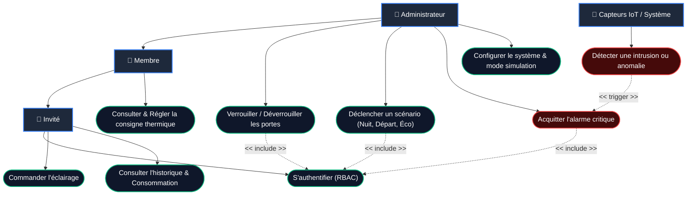
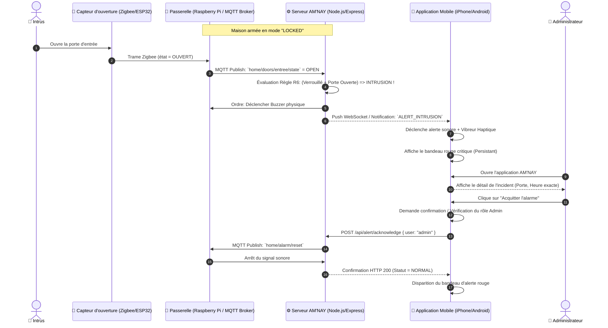

# 📊 Dossier d'Architecture & 3 Diagrammes Clés — AM'NAY
## Soutenance de Licence en Génie Logiciel (L3)

Ce document rassemble les **3 diagrammes indispensables** pour la soutenance de votre projet de maison intelligente **AM'NAY**, modélisés selon les normes du **Génie Logiciel (UML & Architecture Système)** avec la syntaxe standard **Mermaid**.

---

## 📑 Sommaire
1. [Diagramme 1 : Diagramme de Cas d'Utilisation (Use Case)]
2. [Diagramme 2 : Diagramme de Séquence (Cycle de Vie d'une Alerte & Action)]
3. [Diagramme 3 : Diagramme d'Architecture Système & Déploiement Matériel/Réseau]
4. [Fiche Technique & Arguments pour le Jury de Soutenance]

---

## 1. 🎯 Diagramme de Cas d'Utilisation (Use Case Diagram)

### 📌 Description
Ce diagramme structure les fonctionnalités du système en fonction des différents acteurs et de leurs niveaux de privilèges (modèle de sécurité **RBAC — Role-Based Access Control**).

### 👥 Acteurs identifiés :
* **👑 Administrateur** : Propriétaire du logement, possède tous les droits (pilotage total, gestion des utilisateurs, scénarios, acquittement des alarmes).
* **👤 Membre de la famille** : Résident régulier (contrôle de ses pièces, ajustement limité de température).
* **👋 Invité** : Accès temporaire limité à la consultation et à l'éclairage de la pièce commune (salon).
* **🤖 Système / Capteurs IoT** : Acteur technique automatisé qui émet des mesures et déclenche des événements.



### 💡 Points clés à expliquer au jury :
* **Principe du moindre privilège** : Un invité ne peut pas déverrouiller la porte ni couper l'alarme.
* **Sécurité R5/R6** : Les actions sensibles requièrent obligatoirement une authentification valide.

---

## 2. ⚡ Diagramme de Séquence (Sequence Diagram)

### 📌 Scénario : Détection d'Intrusion & Réaction d'Urgence (Règles R5 & R6)
Ce diagramme détaille la chronologie des échanges lors d'un incident critique : une porte s'ouvre alors que la maison est en mode armé/verrouillé.



### 💡 Points clés à expliquer au jury :
* **Découplage asynchrone** : Le capteur ne connaît pas le smartphone. Tout transite par le protocole MQTT / WebSocket pour une latence inférieure à 100 ms.
* **Persistance de l'alarme (Règle R6)** : L'alerte ne disparaît pas toute seule ; une action humaine volontaire de l'administrateur est obligatoire pour garantir la traçabilité.

---

## 3. 🏗️ Diagramme d'Architecture Système & Déploiement Réseau

### 📌 Description
Ce diagramme expose l'architecture physique et logicielle multiniveaux (**N-Tiers / IoT 3-Tier Architecture**) démontrant la séparation claire des responsabilités.

```mermaid
graph TB
    subgraph COUCHE_TERRAIN ["1. 🌐 Couche Terrain (Capteurs & Actionneurs IoT)"]
        direction LR
        L1["💡 Ampoules & Éclairage"]
        S1["🌡️ Capteur Température & Humidité (DHT22 / Zigbee)"]
        D1["🚪 Détecteur Ouverture Porte/Fenêtre"]
        M1["🚶 Détecteur Mouvement PIR"]
        R1["⚡ Relais Prise & Moteur Serrure"]
    end

    subgraph COUCHE_COMMUNICATION ["2. 📡 Passerelle de Communication"]
        direction TB
        Coord["📡 Coordinateur Zigbee USB (CC2652P)"]
        WifiDirect["📶 Point d'Accès Wi-Fi (2.4 GHz)"]
    end

    subgraph COUCHE_CERVEAU ["3. 🧠 Cerveau Central (Raspberry Pi 4 / PC Local)"]
        direction TB
        Z2M["Zigbee2MQTT / Drivers Série"]
        Broker["Broker MQTT (Eclipse Mosquitto)"]
        API["Backend API REST & WebSockets (Node.js / Express)"]
        DB[(Base de Données Événements & SQLite / Timescale)]

        Z2M <-->|Pub / Sub| Broker
        Broker <-->|Events & Triggers| API
        API <-->|Persistence| DB
    end

    subgraph COUCHE_PRESENTATION ["4. 📱 Couche Présentation (Clients Utilisateur)"]
        direction LR
        AppMobile["📱 Application Mobile AM'NAY (React Native / Expo 57 / iOS 18)"]
        WebAdmin["💻 Tableau de Bord Web Administrateur (Navigateur PC)"]
    end

    %% Connexions physiques et protocolaires
    L1 & S1 & D1 & M1 <-->|Zigbee 3.0 / 2.4 GHz| Coord
    R1 <-->|Wi-Fi HTTP / MQTT| WifiDirect

    Coord -->|Liaison Série USB /dev/ttyUSB0| Z2M
    WifiDirect <-->|TCP/IP Réseau Local| Broker

    API <-->|HTTP REST & WebSocket (JSON)| AppMobile
    API <-->|HTTP REST & SSE| WebAdmin
```

---

## 📋 Tableau Récapitulatif des 3 Diagrammes (Pour ton oral)

| N° | Nom du Diagramme | Type UML | Rôle lors de la soutenance |
|:---:|---|---|---|
| **1** | **Cas d'Utilisation** | Fonctionnel | Prouve la gestion des profils (**RBAC**), les droits d'accès et les cas nominaux. |
| **2** | **Séquence** | Dynamique | Démontre la gestion temps réel des alertes critiques, le découplage asynchrone et les règles métier (**R5/R6**). |
| **3** | **Architecture & Déploiement** | Structurel / Physique | Montre la maîtrise de l'écosystème complet : matériel, protocoles IoT (**Zigbee, MQTT**), passerelle et application mobile. |

---

## 🎯 Réponses aux Questions Pièges Fréquentes du Jury

1. **Pourquoi utiliser MQTT plutôt qu'une simple API REST pour les capteurs ?**
   * *Réponse :* Le protocole MQTT est ultra-léger (en-tête de 2 octets), optimisé pour les réseaux contraints et fonctionne en publication/souscription (**Pub/Sub**), évitant ainsi le "polling" consommateur d'énergie pour les capteurs sur pile.
2. **Pourquoi choisir Zigbee pour les capteurs plutôt que le Wi-Fi ?**
   * *Réponse :* Le Wi-Fi est trop énergivore (batterie vidée en quelques semaines). Zigbee fonctionne en réseau maillé (**Mesh**) avec une autonomie de batterie de 1 à 2 ans sur pile bouton (CR2032).
3. **Que se passe-t-il en cas de coupure d'Internet ?**
   * *Réponse :* Le système AM'NAY fonctionne en **Local-First**. Le Raspberry Pi gère la logique d'automatisation sur le réseau local sans dépendre d'un serveur cloud externe. L'application mobile continue de fonctionner tant que le smartphone est connecté au Wi-Fi de la maison.
